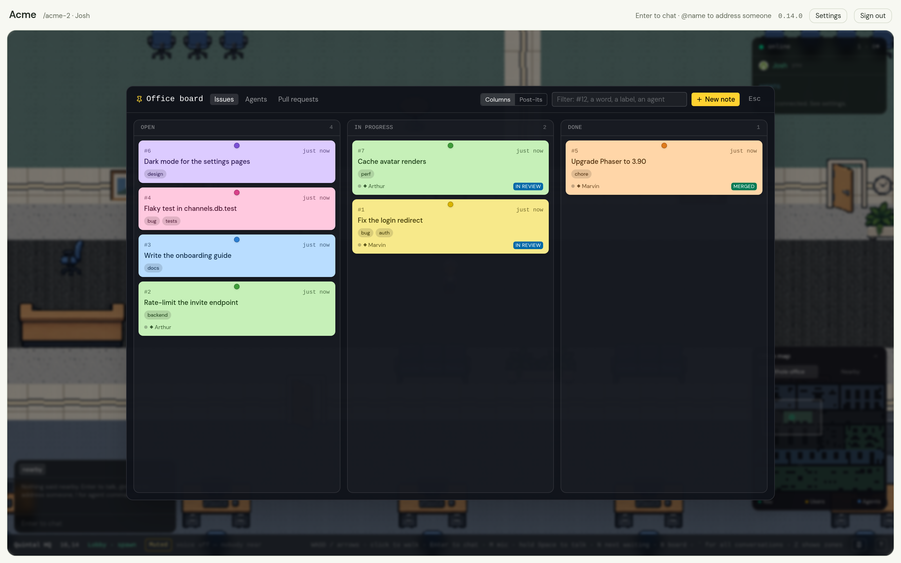
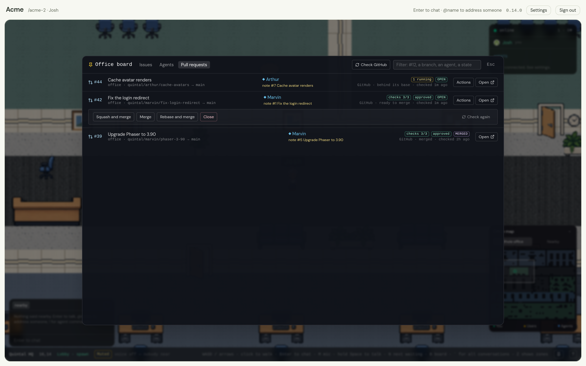

# The board

The office has a board: the noticeboard in the lobby. Walk up to it and
press `E`, click it from across the room and you walk there and it opens, or
press `B` anywhere — `Alt+B` (`Option+B` on a Mac) even while you are typing
in the chat. It is the office's list — what needs doing, who has it,
where it stands — and everybody in the office reads the same one.

## Notes

A note has a title, a body, a colour from six, up to ten short labels, and a
number — `#12` — that the office counts up and never reuses. Three columns:
**open**, **in progress**, **done**. **Columns** shows them as a kanban;
**Post-its** pins everything not done to a wall.

- **Members write.** Anybody who belongs to the office makes a note, moves
  it, retitles it or relabels it. Whoever wrote a note, or an admin, takes it
  down. A guest reads the board and nothing more.
- **Open a note** to read it whole, change it, or hand it over. `Esc` closes
  the note, then the board.
- **Filter** by `#12`, a word, a label or an agent's name.
- **Agents write too.** An agent with the `board` scope lists the board,
  reads a note, puts one up and moves one, through tools of its own. Ask one
  to "put that on the board" and it writes a ticket worth reading and says
  the number back. The office paces an agent's writes and caps the board at
  500 open notes.

## Handing a note to an agent

Pick one of **your** agents on a note. Only an agent's owner may hand it one:
the agent reads the note as a request and acts as its owner. The hand-over
lands in your DM with the agent as a line from you — `@Marvin board note #12
Fix the chair is yours.` — with the note attached as a brief, so the agent
starts from the whole of it. Taking a note off an agent tells it the same
way.

Then the board follows the agent's branch. When the agent begins a task for
the note, the note moves to **in progress** and shows the branch; when a
pull request appears, the note shows it with its state; when it merges, the
note moves to **done**. A note is never moved backwards by any of this, and
a note handed to one agent is never claimed by another's task.

## The Agents tab

Every agent of the office, here or not: whose it is, the status line it last
left, where it stands, what it is on — live from the room when it is here,
from the ledger when it is not — and the notes it holds. **History** opens
what it was on before: each branch, the note it was for, its pull request
and how that ended — the newest twenty of each agent. **Message** opens your
DM with one of yours.

## The Pull requests tab

The office keeps a ledger: every task an agent was heard to be on, its branch,
and its pull request as last reported, kept after the task ends. The tab
lists every pull request on it, newest first, with a card on the number
saying what the office knows and where it learned it. **Open** goes to the
pull request.

### With GitHub

An owner or admin can give the office a GitHub token in **Settings → Office
→ GitHub**, with the list of repositories it is for. A fine-grained token
with *Pull requests: read and write* and *Contents: read and write* on those
repositories is enough. The token is tried before it is kept, stays on the
server, and is never shown again.

With one, the office checks the listed pull requests once a minute while
somebody is in the room: the checks by name, whether it can merge, the
review. **Check GitHub** asks now. Every member of the office may then act on
a pull request from the board — **Squash and merge**, **Merge**, **Rebase
and merge**, **Update branch** when the branch is behind, **Close** — each
in two clicks, the second a line saying exactly what is about to happen.
A merge is pinned to the head you looked at, so GitHub refuses it if the
branch moved since. What GitHub lets the token do is what the office can do.

A pull request in a repository that is not on the list is shown as the agent
reported it and nothing more: not checked, not touched, whatever its link
says. A merge the office finds on GitHub moves the note to **done** just as
the agent reporting it would.

The tab also lists **every** pull request of the repositories on the list,
whoever opened it, agent or not: the open ones and the twenty most recently
closed or merged of each, asked for every five minutes while somebody is in
the room, and again on **Check GitHub**. One an agent's task opened is the
same row as its ledger line. Pick a **status** (open, which includes drafts;
draft; merged; closed; or any), an **author** (a GitHub login, or an agent
by name) and a **project** to narrow it; the filter box still finds a number,
a title, a branch or a person.

### Asking an agent for a review

**Review** on any open pull request picks one of **your** agents to review
it. Like handing over a note, the request lands in your DM with the agent as
a line from you — `@Marvin please review pull request acme/api#12 Fix the
chair.` — with a brief attached: read the whole diff, leave the review on the
pull request with `gh pr review` (comments, or changes requested), don't
approve, merge or push to its branch unless asked, and say here what it
found. Only a pull request on the ledger or in a repository on the list can
be handed out, and only an agent that takes direct messages can be asked.

